  

  <h1>SARAVIAH</h1>

  

    <strong>Systems and Telecommunications Engineering Student</strong> 
    Software Developer | Web &amp; Mobile Development
  

 

Soy estudiante de Ingeniería de Sistemas y Telecomunicaciones, interesado en el desarrollo de software y la creación de soluciones digitales.

Me gusta desarrollar páginas web, aplicaciones móviles y sistemas que combinen funcionalidad, diseño y buenas prácticas de programación.

Disfruto explorar nuevas tecnologías, experimentar con interfaces, desarrollar experiencias interactivas y aprender sobre arquitectura de software y seguridad informática.

Mi objetivo es transformar ideas en soluciones digitales funcionales, intuitivas y bien estructuradas.

---

## Ecosistema tecnológico

  

---

## A little about me

Me motiva convertir ideas en soluciones digitales claras, funcionales y bien pensadas. Disfruto tanto diseñar interfaces intuitivas como estructurar la lógica interna que sostiene aplicaciones web y móviles.

- Crear soluciones digitales útiles y bien estructuradas.
- Desarrollar aplicaciones web y móviles adaptables.
- Diseñar interfaces claras e intuitivas.
- Aprender nuevas tecnologías de forma constante.
- Explorar la arquitectura y organización del software.
- Experimentar con proyectos creativos e interactivos.

---

## Áreas de interés

| **Web Development** | **Mobile Development** |
| :--- | :--- |
| Creación de sitios web, plataformas y sistemas digitales. | Desarrollo de aplicaciones móviles y experiencias multiplataforma. |

| **Software Engineering** | **Cybersecurity** |
| :--- | :--- |
| Programación, arquitectura, bases de datos y diseño de soluciones. | Fundamentos de seguridad informática y protección de aplicaciones. |

---

## Conocimientos y aprendizaje

**Áreas que ya he trabajado**
- Desarrollo web orientado a interfaces y lógica de servidor.
- Lógica de programación y programación orientada a objetos.
- Bases de datos relacionales, modelado y consultas SQL.
- Diseño de interfaces y diseño responsive.
- Control de versiones y organización del código.

**Áreas que continúo desarrollando**
- Desarrollo de aplicaciones móviles y multiplataforma.
- Diseño de APIs, servicios web y persistencia de datos.
- Arquitectura de software, modelado UML y documentación técnica.
- Contenedores, entornos de desarrollo y despliegue en la nube.
- Sistemas de diseño, prototipado y experiencia de usuario.

**Áreas que estoy explorando**
- Fundamentos de ciberseguridad y seguridad básica de aplicaciones.
- Conceptos de redes y protección de la información.
- Arquitectura de sistemas y diseño de soluciones.

---

  
<strong>SARAVIAH</strong> — <em>Building ideas into digital experiences.</em>

  

    <a href="https://github.com/SaraviaH">GitHub</a> ·
    <a href="mailto:josesaraviahuaman@gmail.com">Email</a>
  

