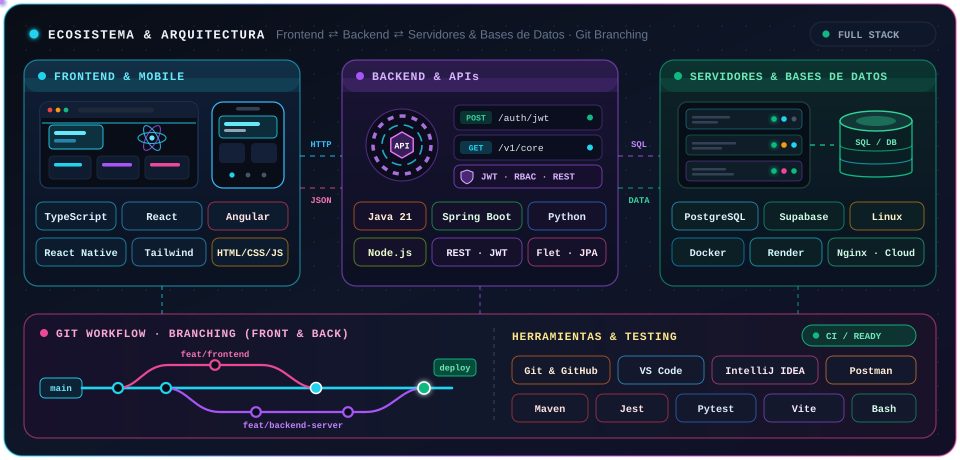

  

 

## 👨‍💻 Sobre mí

Hola, soy **José Saravia** (`@SaraviaH`), desarrollador **Full Stack & Mobile** y estudiante de **Ingeniería de Sistemas** en Perú. Me apasiona diseñar y construir aplicaciones completas de principio a fin, cuidando tanto la experiencia visual en el **Frontend** como la solidez, seguridad y escalabilidad en el **Backend** y los **servidores**.

- 🎨 **Frontend & Mobile:** construcción de interfaces modernas, responsivas y modulares para web y móvil.
- ⚙️ **Backend & APIs:** diseño de arquitecturas cliente–servidor, APIs REST seguras (JWT / RBAC) y lógica de negocio mantenible.
- 🖥️ **Servidores & Datos:** modelado de bases de datos relacionales, despliegue en la nube y administración de entornos Linux/Docker.
- 🌿 **Flujo de trabajo profesional:** control de versiones con Git (branching, merges ordenados), pruebas automatizadas y código limpio.

---

## ⚡ Ecosistema: Frontend, Backend, Servidores & Git

  

---

## 🛠️ Lenguajes, Frameworks & Herramientas

### 🎨 Frontend & Mobile

  
  
  
  
  
  
  
  
  
  

### ⚙️ Backend & APIs

  
  
  
  
  
  

### 🖥️ Servidores, Bases de Datos & Cloud

  
  
  
  
  
  
  

### 🌿 Git, Branching, Testing & Entorno

  
  
  
  
  
  
  
  

---

## 📫 Contacto

  
  
  <!-- Descomenta y reemplaza con tu enlace cuando quieras agregar LinkedIn:
  
  -->

 

  

