  

  <h1>Jose SaraviaH</h1>

  

    <strong>Estudiante de Ingeniería de Sistemas e Informática</strong> 
    <em>Desarrollo de software | Web, aplicaciones móviles y tecnología.</em>
  

 

---

## Sobre mí

¡Hola! Soy Jose, me gusta programar, crear páginas web y desarrollar aplicaciones. Disfruto experimentar con nuevas ideas, aprender tecnologías y convertir pequeños conceptos en experiencias digitales. Siempre estoy buscando algo nuevo que construir.

 

---

## Ecosistema tecnológico

Cada especialidad se organiza como un sistema orbital independiente.

 

  
<strong>Programming Languages &nbsp;|&nbsp; Backend Development</strong>

   
  <table width="100%">
    <tr>
      <th width="50%">Programming Languages</th>
      <th width="50%">Backend Development</th>
    </tr>
    <tr>
      <td width="50%" align="center" valign="top">
        
      </td>
      <td width="50%" align="center" valign="top">
        
      </td>
    </tr>
  </table>

  
<strong>Frontend Development &nbsp;|&nbsp; Mobile Development</strong>

   
  <table width="100%">
    <tr>
      <th width="50%">Frontend Development</th>
      <th width="50%">Mobile Development</th>
    </tr>
    <tr>
      <td width="50%" align="center" valign="top">
        
      </td>
      <td width="50%" align="center" valign="top">
        
        
* Flutter en etapa de exploración.

      </td>
    </tr>
  </table>

  
<strong>Databases &nbsp;|&nbsp; Cloud &amp; Infrastructure</strong>

   
  <table width="100%">
    <tr>
      <th width="50%">Databases</th>
      <th width="50%">Cloud &amp; Infrastructure</th>
    </tr>
    <tr>
      <td width="50%" align="center" valign="top">
        
      </td>
      <td width="50%" align="center" valign="top">
        
      </td>
    </tr>
  </table>

  
<strong>Tools &amp; DevOps &nbsp;|&nbsp; Software Design</strong>

   
  <table width="100%">
    <tr>
      <th width="50%">Tools &amp; DevOps</th>
      <th width="50%">Software Design</th>
    </tr>
    <tr>
      <td width="50%" align="center" valign="top">
        
      </td>
      <td width="50%" align="center" valign="top">
        
      </td>
    </tr>
  </table>

---

## Conocimientos y aprendizaje

 

<table width="100%">
  <tr>
    <td width="33%" valign="top">
      <strong>Áreas que he trabajado</strong>
      <ul>
        <li>Desarrollo de aplicaciones web.</li>
        <li>Desarrollo de aplicaciones móviles.</li>
        <li>Programación orientada a objetos.</li>
        <li>Bases de datos relacionales y SQL.</li>
        <li>Interfaces responsive.</li>
      </ul>
    </td>
    <td width="33%" valign="top">
      <strong>Áreas que sigo desarrollando</strong>
      <ul>
        <li>Arquitectura de software.</li>
        <li>Diseño de APIs REST.</li>
        <li>Persistencia y gestión de datos.</li>
        <li>Integración de servicios.</li>
        <li>Experiencia de usuario.</li>
      </ul>
    </td>
    <td width="33%" valign="top">
      <strong>Áreas que estoy explorando</strong>
      <ul>
        <li>Ciberseguridad aplicada.</li>
        <li>Redes y protección de la información.</li>
        <li>Nuevas tecnologías de desarrollo.</li>
        <li>Desarrollo multiplataforma.</li>
      </ul>
    </td>
  </tr>
</table>

---

## Redes

  
  <!-- Agrega aquí tus otras redes reales cuando tengas sus URLs configuradas -->

---

 

  

    

  

  
<strong>Eso es todo por ahora. ¡Gracias por visitar mi perfil!</strong> ✦

