  

  <h1>SARAVIAH</h1>

  

    <strong>Systems and Telecommunications Engineering Student</strong> 
    Software Developer | Web, Mobile &amp; Tech Research
  

 

<table width="100%">
  <tr>
    <td width="50%" valign="top">
      <h3>👨‍💻 Sobre mí</h3>
      

        👋 ¡Hola! Soy estudiante de <strong>Ingeniería de Sistemas y Telecomunicaciones</strong>, apasionado por el desarrollo de software y la creación de soluciones digitales.
      

      

        📱💻 He creado <strong>aplicaciones móviles con React Native</strong> y <strong>aplicaciones web con React, Next.js y Angular</strong>, además de servicios backend con <strong>Java, Spring Boot y Python</strong>, combinando funcionalidad, diseño y buenas prácticas.
      

      

        🚀 Mi objetivo es transformar ideas en soluciones digitales funcionales, intuitivas y bien estructuradas.
      

    </td>
    <td width="50%" valign="top">
      <h3>🔬 Investigación y Enfoque</h3>
      

        Disfruto investigar nuevas tecnologías, experimentar con interfaces interactivas y entender cómo se organizan los sistemas desde su arquitectura hasta su despliegue.
      

      <ul>
        <li>🔎 <strong>Investigación tecnológica:</strong> exploración continua de herramientas modernas y flujos de desarrollo.</li>
        <li>🧩 <strong>Arquitectura de software:</strong> organización modular, modelado UML y documentación técnica.</li>
        <li>☁️ <strong>Servicios y nube:</strong> APIs, bases de datos relacionales, contenedores y despliegue continuo.</li>
        <li>🛡️ <strong>Seguridad informática:</strong> fundamentos de redes y buenas prácticas de protección en aplicaciones.</li>
      </ul>
    </td>
  </tr>
</table>

---

## 🪐 Technology Ecosystem

Cada especialidad funciona como un **sistema orbital independiente**, organizado en **lotes (Izquierda | Derecha)** para explorar mis conocimientos sin sobrecargar la vista.

  
<strong>📦 Lote 01 · Core &amp; Backend</strong> — <code>💻 Programming Languages</code> | <code>⚙️ Backend Development</code>

   
  <table width="100%">
    <tr>
      <th width="50%">💻 Programming Languages</th>
      <th width="50%">⚙️ Backend Development</th>
    </tr>
    <tr>
      <td width="50%" align="center" valign="top">
        
      </td>
      <td width="50%" align="center" valign="top">
        
      </td>
    </tr>
  </table>

  
<strong>📦 Lote 02 · Frontend &amp; Mobile</strong> — <code>🎨 Frontend Development</code> | <code>📱 Mobile Development</code>

   
  <table width="100%">
    <tr>
      <th width="50%">🎨 Frontend Development</th>
      <th width="50%">📱 Mobile Development</th>
    </tr>
    <tr>
      <td width="50%" align="center" valign="top">
        
      </td>
      <td width="50%" align="center" valign="top">
        
        
* Flutter en etapa de exploración y aprendizaje activo.

      </td>
    </tr>
  </table>

  
<strong>📦 Lote 03 · Databases &amp; Cloud</strong> — <code>🗄️ Databases</code> | <code>☁️ Cloud &amp; Deployment</code>

   
  <table width="100%">
    <tr>
      <th width="50%">🗄️ Databases</th>
      <th width="50%">☁️ Cloud &amp; Deployment</th>
    </tr>
    <tr>
      <td width="50%" align="center" valign="top">
        
      </td>
      <td width="50%" align="center" valign="top">
        
      </td>
    </tr>
  </table>

  
<strong>📦 Lote 04 · DevOps &amp; Design</strong> — <code>🛠️ DevOps &amp; Development Tools</code> | <code>📐 Software Design</code>

   
  <table width="100%">
    <tr>
      <th width="50%">🛠️ DevOps &amp; Development Tools</th>
      <th width="50%">📐 Software Design</th>
    </tr>
    <tr>
      <td width="50%" align="center" valign="top">
        
      </td>
      <td width="50%" align="center" valign="top">
        
      </td>
    </tr>
  </table>

---

## 🌱 Conocimientos y aprendizaje

<table width="100%">
  <tr>
    <td width="33%" valign="top">
      <strong>✅ Áreas que ya he trabajado</strong>
      <ul>
        <li>Apps web con React, Next.js, Angular y backend.</li>
        <li>Apps móviles multiplataforma con React Native.</li>
        <li>Lógica de programación y POO.</li>
        <li>Bases de datos relacionales y SQL.</li>
        <li>Diseño responsive y control de versiones.</li>
      </ul>
    </td>
    <td width="33%" valign="top">
      <strong>🔧 Áreas que continúo desarrollando</strong>
      <ul>
        <li>Diseño de APIs REST y persistencia de datos.</li>
        <li>Arquitectura de software y modelado UML.</li>
        <li>Contenedores y despliegue en la nube.</li>
        <li>Sistemas de diseño y experiencia de usuario.</li>
      </ul>
    </td>
    <td width="33%" valign="top">
      <strong>🔬 Áreas que estoy explorando</strong>
      <ul>
        <li>Investigación tecnológica aplicada.</li>
        <li>Fundamentos de ciberseguridad en apps.</li>
        <li>Redes y protección de la información.</li>
        <li>Nuevas propuestas multiplataforma (Flutter).</li>
      </ul>
    </td>
  </tr>
</table>

---

  
<strong>SARAVIAH</strong> — <em>Building ideas into digital experiences.</em>

  

    🐙 <a href="https://github.com/SaraviaH">GitHub</a> ·
    📫 <a href="mailto:josesaraviahuaman@gmail.com">Email</a> ·
    🌐 <a href="https://saraviah.github.io/SaraviaH/">Perfil Web Interactivo</a>
  

