  

  <h1>Jose SaraviaH</h1>

  

    <strong>Estudiante de Ingeniería de Sistemas e Informática</strong> 
    <em>Desarrollo de software | Web, aplicaciones móviles y tecnología.</em>
  

 

---

## Sobre mí

  ¡Hola! Soy <strong>Jose</strong> y disfruto dar forma a ideas a través del código. Me gusta crear páginas web y aplicaciones móviles cuidando tanto la experiencia visual como que todo funcione de forma clara, ordenada y fluida.

  Me mueve la curiosidad: suelo experimentar con enfoques nuevos, investigar cómo funcionan las cosas por dentro y aprender algo distinto en cada proyecto. Si un concepto puede convertirse en una experiencia digital útil y bien hecha, me entusiasma construirlo.

 

---

## Ecosistema tecnológico

  Estas son las tecnologías y herramientas con las que trabajo, organizadas como sistemas orbitales independientes según su función. 
  Puedes expandir cada bloque para ver desde los lenguajes y servidores hasta el diseño y despliegue en la nube.

 

  
<strong>Programming Languages &nbsp;|&nbsp; Backend Development</strong>

   
  <table width="100%">
    <tr>
      <th width="50%">Programming Languages</th>
      <th width="50%">Backend Development</th>
    </tr>
    <tr>
      <td width="50%" align="center" valign="top">
        
      </td>
      <td width="50%" align="center" valign="top">
        
      </td>
    </tr>
  </table>

  
<strong>Frontend Development &nbsp;|&nbsp; Mobile Development</strong>

   
  <table width="100%">
    <tr>
      <th width="50%">Frontend Development</th>
      <th width="50%">Mobile Development</th>
    </tr>
    <tr>
      <td width="50%" align="center" valign="top">
        
      </td>
      <td width="50%" align="center" valign="top">
        
        
* Flutter en etapa de exploración.

      </td>
    </tr>
  </table>

  
<strong>Databases &nbsp;|&nbsp; Cloud &amp; Infrastructure</strong>

   
  <table width="100%">
    <tr>
      <th width="50%">Databases</th>
      <th width="50%">Cloud &amp; Infrastructure</th>
    </tr>
    <tr>
      <td width="50%" align="center" valign="top">
        
      </td>
      <td width="50%" align="center" valign="top">
        
      </td>
    </tr>
  </table>

  
<strong>Tools &amp; DevOps &nbsp;|&nbsp; Software Design</strong>

   
  <table width="100%">
    <tr>
      <th width="50%">Tools &amp; DevOps</th>
      <th width="50%">Software Design</th>
    </tr>
    <tr>
      <td width="50%" align="center" valign="top">
        
      </td>
      <td width="50%" align="center" valign="top">
        
      </td>
    </tr>
  </table>

---

## Conocimientos y aprendizaje

  Me gusta mostrar mi progreso de forma honesta: lo que ya he aplicado en la práctica, lo que estoy perfeccionando día a día y las áreas nuevas en las que estoy dando mis primeros pasos.

 

<table width="100%">
  <tr>
    <td width="33%" valign="top">
      <strong>Áreas que he trabajado</strong>
      <ul>
        <li>Desarrollo de aplicaciones web.</li>
        <li>Desarrollo de aplicaciones móviles.</li>
        <li>Programación orientada a objetos.</li>
        <li>Bases de datos relacionales y SQL.</li>
        <li>Interfaces responsive.</li>
      </ul>
    </td>
    <td width="33%" valign="top">
      <strong>Áreas que sigo desarrollando</strong>
      <ul>
        <li>Arquitectura de software.</li>
        <li>Diseño de APIs REST.</li>
        <li>Persistencia y gestión de datos.</li>
        <li>Integración de servicios.</li>
        <li>Experiencia de usuario.</li>
      </ul>
    </td>
    <td width="33%" valign="top">
      <strong>Áreas que estoy explorando</strong>
      <ul>
        <li>Ciberseguridad aplicada.</li>
        <li>Redes y protección de la información.</li>
        <li>Nuevas tecnologías de desarrollo.</li>
        <li>Desarrollo multiplataforma.</li>
      </ul>
    </td>
  </tr>
</table>

---

## Redes

  
Si quieres ver en qué ando trabajando o conectar conmigo, puedes encontrarme aquí:

  
  <!-- Agrega aquí tus otras redes reales cuando tengas sus URLs configuradas -->

 

---

 

  

    

  
  &nbsp;&nbsp;&nbsp;&nbsp;
  
  &nbsp;&nbsp;&nbsp;&nbsp;
  

  
<strong>Eso es todo por ahora. ¡Gracias por pasarte por mi perfil!</strong> ✦

